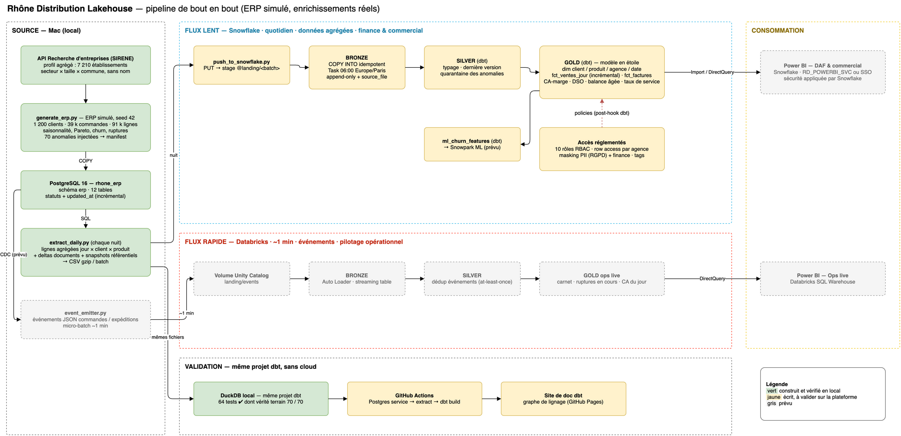

# Rhône Distribution Lakehouse

**Un distributeur B2B lyonnais, deux plateformes, chacune selon son SLA.**
Snowflake pour le pilotage financier et commercial (quotidien, données agrégées, accès réglementés),
Databricks pour le pilotage opérationnel en quasi temps réel, Power BI en restitution.



> **Données :** *Rhône Distribution* est une entreprise **fictive**. Son ERP est **simulé** par un générateur reproductible.
> Le profil de ses clients (secteurs NAF, tailles, communes) provient de données **réelles** : un agrégat SIRENE de 7 210 établissements du Rhône, de l'Ain, de l'Isère et de la Loire.
> Aucun nom d'entreprise ni SIREN réel n'est associé à un historique simulé. Les e-mails utilisent `example.com` et les téléphones la plage réservée à la fiction par l'ARCEP.

> **Statut :** flux lent construit avec **dbt Core** et validé de bout en bout **en local** (PostgreSQL + DuckDB, 64 tests, rejoué à chaque push par la CI).
> Scripts Snowflake (chargement, Task, rôles, row access, masking, tags) écrits et prêts, **pas encore exécutés sur un compte Snowflake**.
> Flux Databricks et rapports Power BI : prévus.

## La question métier

Un distributeur de fournitures industrielles (EPI, outillage, fixation, plomberie, électricité), avec 5 agences et environ 1 200 clients professionnels, veut :

- **DAF** : chiffre d'affaires, marge, DSO, balance âgée, et ces données jamais visibles par tout le monde.
- **Direction commerciale** : performance par agence, famille de produits et commercial, taux de service.
- **Commerciaux** : leurs clients et leurs contacts, **uniquement dans leur agence**, sans les coûts d'achat.
- **Anticiper** : quels clients vont partir ? (features prêtes pour Snowpark ML)

## Architecture

| | Flux lent — **Snowflake** | Flux rapide — **Databricks** |
|---|---|---|
| Latence | quotidienne (extract la nuit, chargement à 6 h) | ~1 min (micro-batch) |
| Données | lignes **agrégées** jour × client × produit × agence, documents en delta, référentiels en snapshot | événements commandes / expéditions |
| Couches | Bronze (COPY INTO) → Silver (dbt) → Gold (dbt) | Bronze (Auto Loader) → Silver → Gold |
| Usage | finance, commercial, ML | carnet du jour, ruptures en cours |

Le schéma éditable est dans [`docs/pipeline.drawio`](docs/pipeline.drawio) (ouvrir avec draw.io ou diagrams.net). Les choix sont détaillés dans [`docs/ARCHITECTURE.md`](docs/ARCHITECTURE.md).

## Accès réglementés (Snowflake)

| Rôle | Agences visibles | Contacts clients (RGPD) | Coûts et marges |
|---|---|---|---|
| `RD_DAF` | toutes | en clair | en clair |
| `RD_DIRECTION_COMMERCIALE` | toutes | masqués | en clair |
| `RD_ANALYSTE` | toutes | masqués | masqués |
| `RD_COMMERCIAL_<AGENCE>` | **la sienne** | en clair | masqués |
| `RD_POWERBI_SVC` | toutes (lecture Gold) | masqués | masqués |

Mise en œuvre :
- **Row access policy** par agence, pilotée par une table de correspondance rôle → agence.
- **Masking policies** `pii_masking` et `finance_masking`.
- **Tags** de classification `pii` et `confidentiel_finance`.

dbt recrée les tables à chaque run, donc les policies sont rattachées par un **post-hook**, à partir du `meta` déclaré dans le YAML des modèles. Bronze et Silver ne sont jamais exposés aux métiers. Le script de démonstration rôle par rôle est [`sql/snowflake/03_verify_security.sql`](sql/snowflake/03_verify_security.sql).

## Qualité de données : une vérité terrain

Le générateur injecte volontairement **70 anomalies** et écrit leur nombre exact dans `anomaly_manifest.csv` :

| Anomalie | Nombre |
|---|---|
| prix à zéro | 25 |
| quantité négative non marquée comme retour | 12 |
| expédition antérieure à la commande | 15 |
| facture orpheline (sans commande) | 10 |
| client sans code postal | 8 |

La couche Silver les isole dans `silver_quarantine`, et un test dbt exige que la quarantaine retrouve **exactement** ce manifeste, ni plus ni moins. Ce test a d'ailleurs déjà servi : une première version de la règle « prix à zéro » produisait 5 faux positifs (une vente annulée par un retour le même jour). Le test a fait échouer le build, et la règle a été corrigée.

## Gold : prêt pour Power BI

| Modèle | Contenu |
|---|---|
| `dim_client`, `dim_produit`, `dim_agence`, `dim_commercial`, `dim_fournisseur`, `dim_date` | dimensions (noms métier en français) |
| `fct_ventes_jour` | ventes au grain jour × client × produit × agence × commercial × canal, **incrémental** |
| `fct_factures` | factures et avoirs, paiements, retard |
| `agg_ca_marge_mensuel`, `agg_taux_service`, `agg_performance_fournisseurs` | pilotage commercial |
| `agg_balance_agee`, `agg_dso_mensuel` | pilotage financier |
| `ml_churn_features` | snapshot mensuel par client, label « aucune commande à 90 jours » |

Ordres de grandeur produits par la simulation : environ 9 M€ de CA annuel, 29,7 % de marge brute, DSO autour de 45 jours, taux de service de 97,7 %.

## Documentation dbt et lignage

La CI publie à chaque push le site de documentation dbt (modèles, tests, graphe de lignage) : https://pduclos.github.io/rhone-distribution-lakehouse/

## Lancer en local (aucun compte cloud nécessaire)

Prérequis : Python 3.12+, PostgreSQL 16, `uv`.

```bash
make setup               # venv + dépendances
make generate            # ERP simulé (Parquet) + manifeste d'anomalies
make postgres            # chargement dans PostgreSQL (base rhone_erp)
make extract-backfill    # extract nocturne, tout l'historique
make dev                 # Bronze DuckDB + dbt build (Silver, Gold, 64 tests)
make docs                # site de documentation + graphe de lignage
```

## Sur Snowflake

1. Exécuter [`sql/snowflake/01_setup.sql`](sql/snowflake/01_setup.sql) (base, schémas, stage, tables Bronze, procédure de chargement, Task), puis [`02_security.sql`](sql/snowflake/02_security.sql).
2. Exporter `SNOWFLAKE_ACCOUNT`, `SNOWFLAKE_USER` et `SNOWFLAKE_PASSWORD`, puis installer `dbt-snowflake` et `snowflake-connector-python`.
3. Lancer `make snowflake-push` (PUT + COPY INTO), puis `make snowflake-build` (dbt build ; les policies sont posées par le post-hook).
4. Exécuter `03_verify_security.sql` rôle par rôle.

## Structure

```
generator/   simulation de l'ERP, chargement PostgreSQL, extract nocturne, chargeurs
reference/   profil SIRENE agrégé (aucune donnée nominative)
models/      silver/ et gold/ (dbt)
sql/         schéma ERP PostgreSQL, scripts Snowflake
seeds/       manifeste des anomalies injectées
docs/        architecture, schéma draw.io
```

## Feuille de route

- [x] ERP simulé et réaliste, PostgreSQL, extract nocturne agrégé
- [x] Bronze / Silver / Gold avec dbt, 64 tests dont la vérité terrain, CI
- [x] Scripts Snowflake : chargement idempotent, Task, RBAC, row access, masking, tags
- [ ] Première exécution sur Snowflake et vérification des policies rôle par rôle
- [ ] Flux rapide Databricks : émetteur d'événements, Auto Loader, pipeline déclaratif
- [ ] Rapports Power BI (DAF / commercial sur Snowflake, ops live sur Databricks)
- [ ] Modèle de churn sous Snowpark ML

---

Projet personnel de Patrice Duclos.
