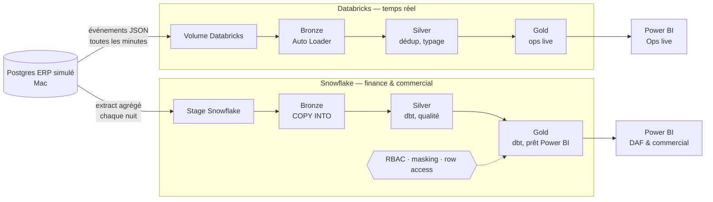

# Architecture — Rhône Distribution Lakehouse

**Scénario :** *Rhône Distribution*, distributeur B2B **fictif** de fournitures industrielles (EPI, outillage, fixation, plomberie, électricité), avec 5 agences dans la région lyonnaise et environ 1 200 clients professionnels (BTP, industrie, maintenance).

**Données :** l'ERP est **simulé** par un générateur Python reproductible (seed fixe, facteur d'échelle). Le profil des clients (secteurs NAF, tailles, communes) vient de données **réelles** : un agrégat SIRENE de 7 210 établissements actifs dans le Rhône, l'Ain, l'Isère et la Loire. Aucun nom d'entreprise ni SIREN réel n'est rattaché à un historique simulé.

## Principe : chaque plateforme selon son SLA

| | Flux rapide | Flux lent |
|---|---|---|
| Plateforme | **Databricks** | **Snowflake** |
| Latence | ~1 min (micro-batch) | quotidienne (J+1, 6 h) |
| Données | événements : commandes, lignes, expéditions, ruptures | extract nocturne **agrégé** : ventes jour × client × produit × agence, factures, encaissements, référentiels |
| Usage | pilotage opérationnel : commandes du jour, carnet, ruptures en cours | pilotage financier et commercial : CA, marge, DSO, balance âgée, performance fournisseurs |
| Lecteurs | chefs d'agence, logistique | DAF, direction commerciale, commerciaux (périmètre restreint) |
| Outils | Auto Loader + Lakeflow Declarative Pipelines (Delta) | stage + `COPY INTO` + Task, dbt, RBAC, masking, row access |

## Couches (médaillon)

| Couche | Rôle | Règles |
|---|---|---|
| **Bronze** | copie brute, append-only, horodatée au chargement | aucun nettoyage, rejouable |
| **Silver** | typage, dédoublonnage, conformité, **anomalies isolées** (quarantaine) | tests dbt bloquants sur les clés |
| **Gold** | modèle en étoile prêt pour Power BI : dimensions + faits + agrégats | noms métier en français, grain documenté, sécurité appliquée |

## Accès réglementés (Snowflake, simulés)

| Rôle | Périmètre | Données sensibles |
|---|---|---|
| `RD_DAF` | toutes agences | tout en clair (marges, coûts, encours) |
| `RD_DIRECTION_COMMERCIALE` | toutes agences | marges visibles, contacts clients masqués |
| `RD_COMMERCIAL_<AGENCE>` | **sa seule agence** (row access policy) | coûts et marges masqués, contacts visibles |
| `RD_ANALYSTE` | toutes agences | données personnelles masquées (RGPD), montants visibles |
| `RD_POWERBI_SVC` | compte de service Power BI | lecture seule sur le Gold |

- **Masking policies** : e-mail et téléphone des contacts clients (données personnelles), coût d'achat et marge (secret commercial), limite de crédit.
- **Row access policy** : un commercial ne voit que les lignes de son agence, via une table de correspondance rôle → agence.
- **Tags** : `pii`, `confidentiel_finance`, rattachés aux colonnes concernées.

## Règles métier simulées (pour que le ML ait du signal)

- **Saisonnalité par segment** : creux du BTP en août et fin décembre, jours ouvrés uniquement, jours fériés français, budget des collectivités en fin d'année.
- **Pareto** : 20 % des clients font environ 80 % du CA.
- **Départ de clients** : environ 12 % des clients partent. Dans les mois précédents, leur fréquence de commande baisse, leur panier diminue et leurs paiements ralentissent.
- **Ruptures** : `qty_shipped < qty_ordered`, causées par la variabilité des délais fournisseurs ; elles augmentent en période de pic.
- **Prix** : inflation annuelle et remises selon le segment et la taille du client.
- **Cycle de vie** : commande → expédiée → facturée → payée, avec `updated_at` pour l'ingestion incrémentale.

## Anomalies injectées (vérité terrain)

Le générateur écrit `anomaly_manifest.csv` (type, nombre exact). Un test dbt vérifie que la quarantaine Silver retrouve **exactement** ces anomalies : doublons de lignes, prix à 0, expédition avant la commande, factures orphelines, quantités négatives non marquées comme retour, clients sans code postal.
